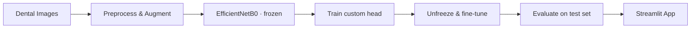

<div align="center">

# 🦷 Teeth Disease Classification — EfficientNetB0

**Transfer learning with EfficientNetB0 to classify dental images into 7 conditions, deployed as an interactive Streamlit app.**


</div>

---

## 📌 Overview

This project compares two approaches to dental image classification:

1. **Custom CNN** trained from scratch — see [Teeth-Classification-CNN](https://github.com/Ammarjm/Teeth-Classification-CNN)
2. **EfficientNetB0** pre-trained on ImageNet, adapted with **transfer learning and fine-tuning** (this repository)

The final model is served through a **Streamlit** web app: upload a dental image and get the predicted condition instantly.

## 🏷️ Classes

`CaS` Caries · `CoS` Calculus · `Gum` Gum Disease · `MC` Mouth Cancer · `OC` Oral Cancer · `OLP` Oral Lichen Planus · `OT` Other

**Dataset split:** 3,087 training · 1,028 validation · 1,028 test images

## ⚙️ Training Strategy



- **Stage 1 — Feature extraction:** frozen EfficientNetB0 backbone with a new classification head (≈ 330 K trainable parameters)
- **Stage 2 — Fine-tuning:** backbone unfrozen and trained with a low learning rate
- **Balanced class weights** to handle uneven class sizes
- **Callbacks:** early stopping · learning-rate reduction · best-model checkpointing

## 📊 Results (Test Set)

| Metric | Score |
|---|---|
| Accuracy | **97 %** |
| Precision | 0.97 |
| Recall | 0.97 |
| F1-Score | **0.97** |

## 🧰 Tech Stack

Python · TensorFlow / Keras · EfficientNetB0 · NumPy · Pandas · OpenCV · Scikit-learn · Matplotlib · Seaborn · Streamlit

## 📂 Project Structure

```text
├── Transfer_Learning.ipynb   # Training, fine-tuning & evaluation
├── app.py                    # Streamlit app
├── models/                   # Saved models (head weights & fine-tuned model)
├── Teeth_Dataset/            # Training / Validation / Testing images
└── requirements.txt
```

## 🚀 Getting Started

```bash
git clone https://github.com/Ammarjm/Teeth-Disease-Classification-EfficientNet.git
cd Teeth-Disease-Classification-EfficientNet
pip install -r requirements.txt
streamlit run app.py
```

## 👤 Author :

**Ammar Alsabateen** — AI & Machine Learning Engineer
[GitHub](https://github.com/Ammarjm) · [Email](mailto:alsabateenammar@gmail.com)
